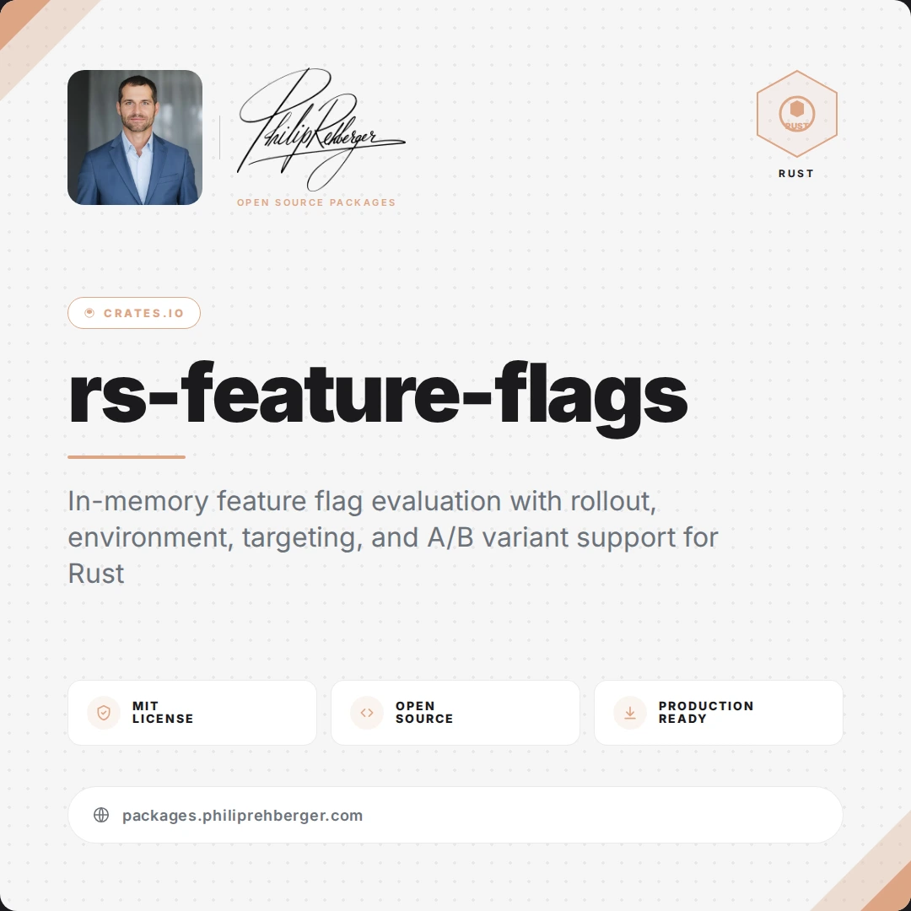

# rs-feature-flags

[](https://github.com/philiprehberger/rs-feature-flags/actions/workflows/ci.yml)
[](https://crates.io/crates/philiprehberger-feature-flags)
[](https://github.com/philiprehberger/rs-feature-flags/commits/main)



In-memory feature flag evaluation with rollout, environment, targeting, and A/B variant support

## Installation

```toml
[dependencies]
philiprehberger-feature-flags = "0.5.0"
```

To enable JSON deserialization via serde:

```toml
[dependencies]
philiprehberger-feature-flags = { version = "0.5.0", features = ["serde"] }
```

## Usage

```rust
use philiprehberger_feature_flags::{FeatureFlags, FlagConfig, Context};

let mut flags = FeatureFlags::new();

flags.set("dark-mode", FlagConfig::new(true));
flags.set(
    "beta-feature",
    FlagConfig::new(true)
        .with_rollout(50)
        .with_environments(vec!["production".into()]),
);

// Simple check
assert!(flags.is_enabled("dark-mode"));

// Check with context
let ctx = Context::new()
    .with_user_id("user-123")
    .with_environment("production");

let enabled = flags.is_enabled_for("beta-feature", &ctx);
println!("beta-feature enabled: {enabled}");
```

### Targeting

Grant access to specific users or roles, bypassing percentage rollout:

```rust
use philiprehberger_feature_flags::{FeatureFlags, FlagConfig, Context};

let mut flags = FeatureFlags::new();
flags.set(
    "internal-tool",
    FlagConfig::new(true)
        .with_rollout(0) // 0% general rollout
        .with_allowed_users(vec!["alice".into(), "bob".into()])
        .with_allowed_roles(vec!["admin".into()]),
);

// Alice gets access via allowed_users
let ctx = Context::new().with_user_id("alice");
assert!(flags.is_enabled_for("internal-tool", &ctx));

// Any admin gets access via allowed_roles
let ctx = Context::new().with_user_id("charlie").with_role("admin");
assert!(flags.is_enabled_for("internal-tool", &ctx));
```

Or use a denylist that takes precedence over allow lists and rollout:

```rust
use philiprehberger_feature_flags::{FeatureFlags, FlagConfig, Context};

let mut flags = FeatureFlags::new();
flags.set(
    "feature-a",
    FlagConfig::new(true)
        .with_rollout(100)
        .with_disallowed_users(vec!["banned-user".into()]),
);

// Banned user is denied even at 100% rollout
let ctx = Context::new().with_user_id("banned-user");
assert!(!flags.is_enabled_for("feature-a", &ctx));
```

You can also require context attributes to match:

```rust
use std::collections::HashMap;
use philiprehberger_feature_flags::{FeatureFlags, FlagConfig, Context};

let mut attrs = HashMap::new();
attrs.insert("plan".to_owned(), "enterprise".to_owned());

let mut flags = FeatureFlags::new();
flags.set(
    "enterprise-only",
    FlagConfig::new(true).with_required_attributes(attrs),
);

let ctx = Context::new().with_attribute("plan", "enterprise");
assert!(flags.is_enabled_for("enterprise-only", &ctx));
```

### Variants

Deterministic A/B test variant assignment based on user ID hashing. Pass the
variant list explicitly:

```rust
use philiprehberger_feature_flags::FeatureFlags;

let flags = FeatureFlags::new();
let variant = flags.get_variant("experiment", "user-42", &["control", "variant-a", "variant-b"]);
// Always returns the same variant for the same flag + user pair
println!("assigned: {}", variant.unwrap());
```

Or configure the variants on the flag and resolve them from a `Context`:

```rust
use philiprehberger_feature_flags::{FeatureFlags, FlagConfig, Context};

let mut flags = FeatureFlags::new();
flags.set(
    "experiment",
    FlagConfig::new(true)
        .with_variants(vec!["control".into(), "variant-a".into(), "variant-b".into()]),
);

let ctx = Context::new().with_user_id("user-42");
let variant = flags.variant_for("experiment", &ctx);
println!("assigned: {}", variant.unwrap());
```

### Explaining a decision

`explain` returns the decision together with the rule that made it, using the
same code path as `is_enabled_for`:

```rust
use philiprehberger_feature_flags::{FeatureFlags, FlagConfig, Context, Reason};

let mut flags = FeatureFlags::new();
flags.set(
    "beta",
    FlagConfig::new(true)
        .with_rollout(0)
        .with_allowed_users(vec!["alice".into()]),
);

let eval = flags.explain("beta", &Context::new().with_user_id("alice"));
assert!(eval.enabled);
assert_eq!(eval.reason, Reason::AllowedUser);

let eval = flags.explain("beta", &Context::new().with_user_id("bob"));
assert!(!eval.enabled);
assert_eq!(eval.reason, Reason::OutOfRollout);
```

### Evaluating all flags

`evaluate_all` resolves every flag for one context, sorted by name, which is
handy for sending a snapshot to a frontend:

```rust
use philiprehberger_feature_flags::{FeatureFlags, FlagConfig, Context};

let mut flags = FeatureFlags::new();
flags.set("dark-mode", FlagConfig::new(true));
flags.set(
    "prod-only",
    FlagConfig::new(true).with_environments(vec!["production".into()]),
);

let ctx = Context::new().with_environment("staging");
let snapshot = flags.evaluate_all(&ctx);
assert_eq!(snapshot.get("dark-mode"), Some(&true));
assert_eq!(snapshot.get("prod-only"), Some(&false));
```

## API

### `FlagConfig`

Configuration for a single flag: enabled, rollout, environments, targeting, variants, attributes.

| Method | Description |
|--------|-------------|
| `new(enabled)` | Create a new flag config |
| `with_rollout(pct)` | Set rollout percentage (0-100) |
| `with_environments(envs)` | Restrict flag to specific environments |
| `with_allowed_users(users)` | Set users that bypass rollout |
| `with_disallowed_users(users)` | Set users that are always denied (precedence over allow lists and rollout) |
| `with_allowed_roles(roles)` | Set roles that bypass rollout (matched against `role` attribute) |
| `with_variants(variants)` | Set variant names for A/B testing |
| `with_required_attributes(attrs)` | Set required context attributes |

### `Context`

Evaluation context with user ID, environment, and custom attributes.

| Method | Description |
|--------|-------------|
| `new()` | Create an empty context |
| `with_user_id(id)` | Set the user ID for rollout evaluation |
| `with_environment(env)` | Set the environment for filtering |
| `with_attribute(key, value)` | Add a custom attribute |
| `with_role(role)` | Set the role attribute (shorthand) |

### `FeatureFlags`

In-memory flag store.

| Method | Description |
|--------|-------------|
| `new()` | Create an empty store |
| `set(name, config)` | Add or update a flag |
| `set_config(name, config)` | Add or update a flag (accepts `&str`) |
| `remove(name)` | Remove a flag |
| `is_enabled(name)` | Check if a flag is enabled (no context) |
| `is_enabled_for(name, ctx)` | Evaluate a flag with full context |
| `evaluate_with_config(name, ctx)` | Evaluate a stored flag with context |
| `explain(name, ctx)` | Evaluate a flag and return an `Evaluation` with the deciding `Reason` |
| `evaluate_all(ctx)` | Evaluate every flag for one context as a sorted `BTreeMap<String, bool>` |
| `get_variant(flag, user_id, variants)` | Get a deterministic A/B variant from an explicit list |
| `variant_for(flag, ctx)` | Get a deterministic A/B variant from the flag's stored variants |
| `get(name)` | Get a reference to a flag's `FlagConfig` |
| `contains(name)` | Check whether a flag exists |
| `set_enabled(name, enabled)` | Toggle a flag's `enabled` state in place |
| `len()` | Number of flags in the store |
| `is_empty()` | True if the store has no flags |
| `clear()` | Remove all flags |
| `all_flags()` | Get a sorted list of all flag names |
| `from_json(json)` | Parse flags from JSON (requires `serde` feature) |
| `to_json()` | Serialize all flags to JSON (requires `serde` feature) |

### `Evaluation`

Result of `FeatureFlags::explain`.

| Field | Type | Description |
|-------|------|-------------|
| `enabled` | `bool` | Whether the flag is enabled for the context |
| `reason` | `Reason` | The rule that decided the outcome |

### `Reason`

Why a flag resolved the way it did (`#[non_exhaustive]`), in evaluation order.

| Variant | Description |
|---------|-------------|
| `NotFound` | No flag with that name exists (disabled) |
| `Disabled` | The flag's base `enabled` is `false` (disabled) |
| `EnvironmentMismatch` | The context's environment is not in the flag's environments (disabled) |
| `MissingEnvironment` | The flag is environment-restricted and the context has no environment (disabled) |
| `AttributeMismatch` | A required attribute is missing or has a different value (disabled) |
| `DisallowedUser` | The user is on the denylist (disabled) |
| `AllowedUser` | The user is on the allow list (enabled) |
| `AllowedRole` | The context's `role` is an allowed role (enabled) |
| `InRollout` | The user falls inside the rollout percentage (enabled) |
| `OutOfRollout` | The user falls outside the rollout percentage (disabled) |
| `MissingUserId` | The flag has a rollout and the context has no user ID (disabled) |
| `Enabled` | The flag is enabled and no rule restricted it (enabled) |

ture) |

## Development

```bash
cargo test
cargo clippy -- -D warnings
```

## Support

If you find this project useful:

⭐ [Star the repo](https://github.com/philiprehberger/rs-feature-flags)

🐛 [Report issues](https://github.com/philiprehberger/rs-feature-flags/issues?q=is%3Aissue+is%3Aopen+label%3Abug)

💡 [Suggest features](https://github.com/philiprehberger/rs-feature-flags/issues?q=is%3Aissue+is%3Aopen+label%3Aenhancement)

❤️ [Sponsor development](https://github.com/sponsors/philiprehberger)

🌐 [All Open Source Projects](https://philiprehberger.com/open-source-packages)

💻 [GitHub Profile](https://github.com/philiprehberger)

🔗 [LinkedIn Profile](https://www.linkedin.com/in/philiprehberger)

## License

[MIT](LICENSE)
